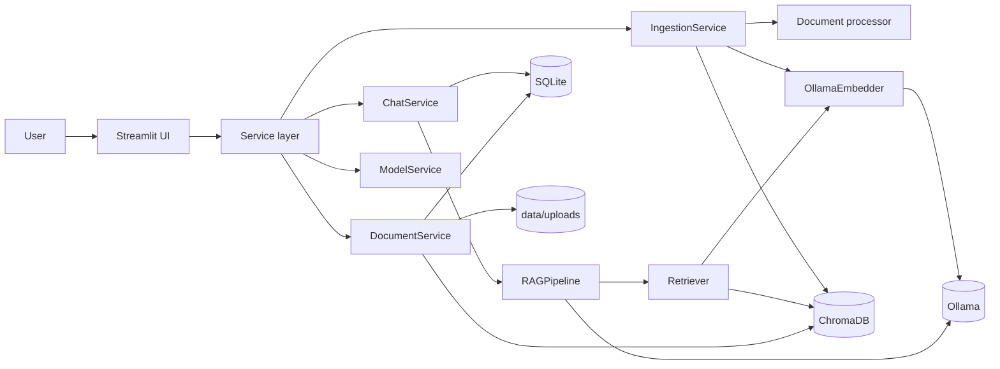
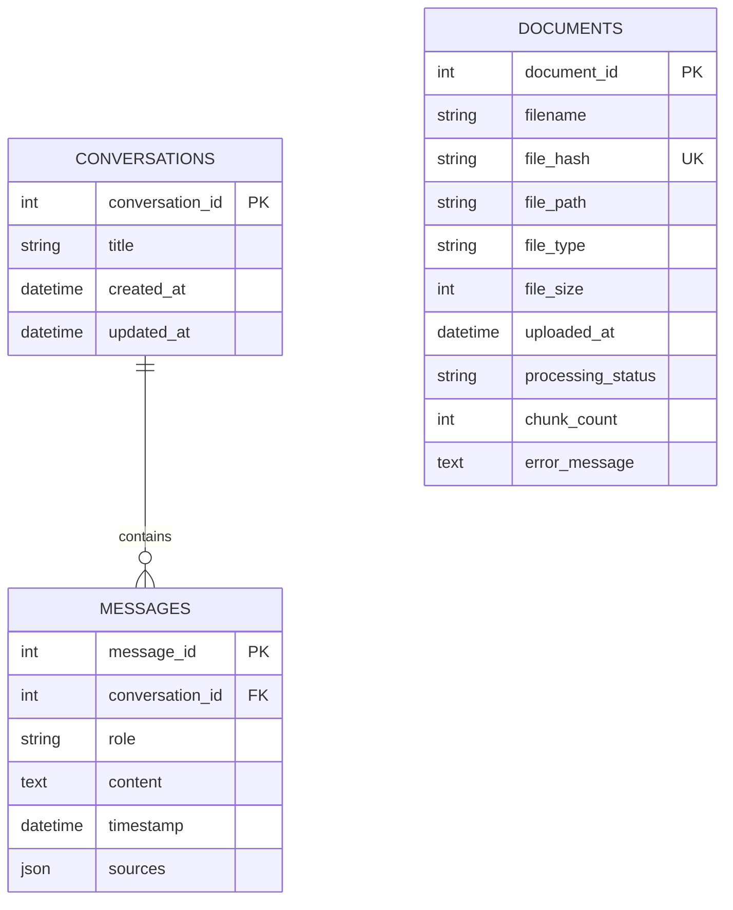

# Architecture

Local RAG AI Assistant is a local-first Retrieval-Augmented Generation application. Every
component runs on the user's machine: **Ollama** generates answers and embeddings, **ChromaDB**
stores vectors, and **SQLite** stores conversations and document metadata. There are no API keys
and no outbound requests except to the local Ollama server.

## Component diagram

## Layers

| Layer | Responsibility |
|---|---|
| `ui/` | Streamlit pages (Chat, Documents, Settings), sidebar and shared components. No business logic. |
| `services/` | Use-case orchestration: ingestion, document lifecycle, chat, model preflight, dependency container. |
| `core/` | Reusable engine: Ollama client, embeddings, Chroma store, document processing, chunking, retrieval, RAG chain, prompts, evaluation. |
| `database/` | SQLAlchemy models, engine/session management and the repository (data access). |
| `config/` | Pydantic settings from `.env` + `data/user_settings.json`, validation and logging. |

Dependencies point downward: `ui -> services -> core/database -> config`. Services never import
Streamlit, and `core` never imports the UI.

## Upload flow

1. Streamlit validates the file count and size, then calls `IngestionService.ingest_bytes`.
2. The filename is sanitised (extension preserved), the extension and size are checked, and a
   SHA-256 hash is computed for duplicate detection.
3. The file is stored under `data/uploads/` and a `Document` row is created with status
   `processing`.
4. `DocumentProcessor` extracts text with real locations (PDF page, DOCX heading, CSV/XLSX sheet
   and rows) and `TextSplitter` produces overlapping chunks.
5. `OllamaEmbedder` embeds the chunks in batches (with `search_document:` prefixes for
   `nomic-embed-text`), and `VectorStore` writes them to ChromaDB.
6. The document is marked `ready` with its chunk count. Any failure marks it `failed`, removes
   partial vectors and records a user-facing message.

## Question flow

1. `ChatService.ask` saves the user message and loads the conversation history.
2. `RAGPipeline` optionally rewrites the question using recent history (disabled when
   `HISTORY_WINDOW=0`), then optionally expands it into multiple queries.
3. `Retriever` embeds the query, searches ChromaDB (similarity or MMR), merges multi-query
   results, applies the similarity threshold and optional per-document scope.
4. If no relevant chunks exist, the pipeline returns a grounded "not enough information" answer
   without calling the LLM.
5. Otherwise it streams tokens from Ollama with a context block and citation markers. The
   assistant message is saved when generation completes, fails or is stopped early (partial
   answers are kept).

## Data model

Vectors live in ChromaDB and carry `document_id`, `filename`, `file_type`, `chunk_index`,
`location`, `page` (when known) and `embedding_model` as metadata. Deleting a document removes
its vectors, metadata row and stored file.

## Design decisions

- **Local-first by default.** The only network endpoint is `OLLAMA_BASE_URL`, which defaults to
  `http://localhost:11434`. No telemetry.
- **User-facing error boundary.** All expected failures derive from `AppError`, whose message is
  safe to display. Unexpected exceptions are logged to `logs/app.log` and shown as a generic
  message.
- **Embedding-model changes are explicit.** ChromaDB fixes a collection's vector dimension when it
  is created, so **Documents -> Maintenance -> Rebuild vector index** deletes the collection and
  re-indexes every stored document. The embedder is validated *before* anything is deleted.
- **Crash-safe metadata.** Settings saves are atomic (`.tmp` + `os.replace`), and document
  statuses are updated before/after indexing so an interrupted operation is visible and
  recoverable.
- **Testability without external services.** `tests/fakes.py` provides in-memory Ollama, embedder
  and Chroma stand-ins, so almost the entire suite runs offline. The single real-Chroma test is
  skipped when `chromadb` is unavailable.
- **Configuration is validated once.** Pydantic rejects invalid `.env` values at startup with a
  field-level message, and UI overrides are persisted separately from environment values.

## Testing strategy

- Unit tests for settings, chunking, embeddings, document processing, evaluation metrics and the
  Ollama client.
- Service tests with a real SQLite database in `tmp_path` and fake vectors.
- Pipeline tests for retrieval, MMR, thresholds, rewriting, history windows and streaming.
- UI-independent by design: no Streamlit imports in tests.
- CI runs `ruff check .` and `pytest -q` on Python 3.11 and 3.12.

## Known limitations

- Image-only PDFs are not OCR'd (a clear error is shown).
- DOCX has no page numbers; citations use the nearest heading.
- CSV/XLSX are indexed as row groups, which suits lookups better than numeric aggregation.
- Streaming stop relies on Streamlit reruns; the partial answer is saved.
- Pinned dependencies target Python 3.11/3.12 (3.13+ is not supported).
